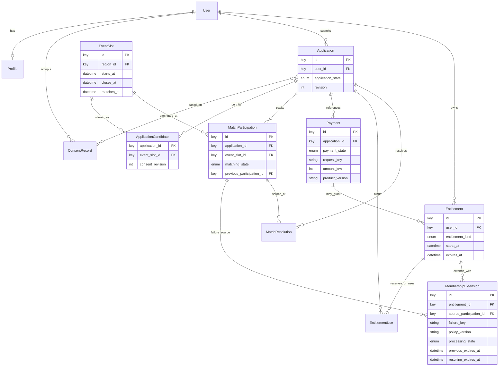
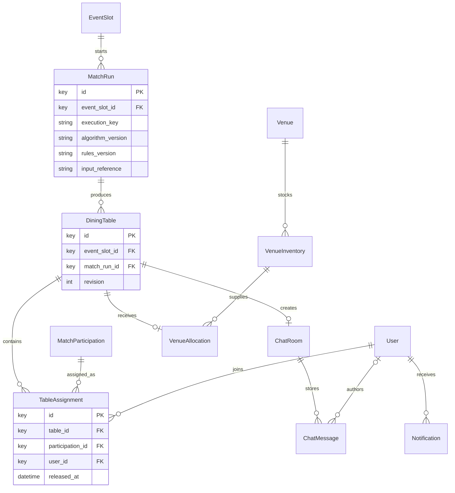
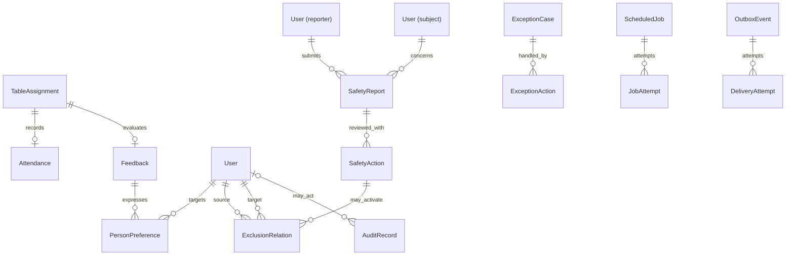
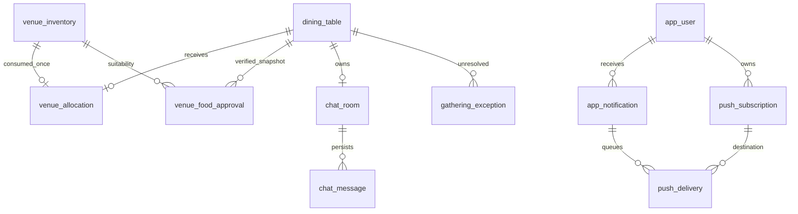

# 핵심 ERD·상태·무결성 제약 설계

## Work #6 실패 해결의 추가 물리 스키마 (0010)

2026-10-17 사용자 승인 정책과 [ADR-0012](../adr/0012-matching-failure-resolution.md)를 구현한다. **격리 시험 DB에만 적용했으며 운영에는 적용하지 않았다.** 기존 전체 ERD는 논리 설계이고 아래 표가 이번 물리 변경이다. [추가 ERD SVG](./erd/matching-resolution.svg)·[PNG](./erd/matching-resolution.png)는 주요 참조 관계를 보여주는 별도 그림이다(외부 user/run/slot 관계 일부 생략).

| 테이블·변경 | 실제 책임·제약 |
|---|---|
| match_resolution | 신청/실패 실행당 선택 1개, 사용자/요청 키 UNIQUE, 소유자 FK, TRANSFER일 때만 대상 회차 필수. 이전 상태·실패 사유·동의 주체·시각·정책을 보존 |
| application_candidate.source_resolution_id | nullable 신규 FK. 기존 행 NULL을 유지해 원제출 멱등 비교를 보존. 과거 후보는 삭제 없이 live=false |
| entitlement_binding | 원권리·원구매 참조와 별도의 신청 예약 이력. 권리·신청 각각 활성 예약 최대 1개, 권리/신청 소유자 복합 FK. 기존 SINGLE은 원신청 예약을 backfill하고 구매/사용/확정 데이터는 변경하지 않음 |
| membership_extension | application_id PK로 동일 신청의 대안 재시도 중복 연장 방지. 이전/결과 만료·정책·시각. 결과는 이전 +7일 CHECK |
| payment.state | 기존 값에 REFUNDED를 추가. 원금·상품·원구매 신청·완료 시각은 보존 |
| mock_refund_event | 원결제/전이 상태 PK, 요청→처리→완료 감사 이력·전액·시각. 실제 PG 호출 없음 |

현재 상태: 실패 → 명시적 이동 이력 TRANSFERRED + 현재 WAITING, 보관/모의 환불 → NO_MATCH와 사유. 권리는 활성 예약과 영구 배치 이력으로 판정하며 이미 사용한 권리를 되살리지 않는다. 매칭 성공·오류 기록·해결·재사용은 같은 transaction advisory lock을 첫 잠금으로 사용한다. 스케줄·점수 알고리즘·기존 확정 테이블은 유지한다. 환불된 데이터가 있는 0010 downgrade는 상태 제약으로 거부하며, 운영 복구는 백업/전방 수정 계획을 별도 검토한다.

## Work #5의 원본 응답 준비 영역

2026-10-17 승인된 응답별 식별·누락 보존 규칙에 따라 `0008_source_preparation`이 `source_private.import_batch`와 `response_staging`을 만든다. 앱 사용자/프로필/신청/결제와 FK로 연결하지 않는다. 실제 원본은 별도 로컬 준비 DB에만 적재하고 앱 런타임 DB 연결과 분리한다. [규칙·물리 제약·권한](./source-preparation-contract.md), [별도 ERD 그림](./erd/source-preparation.svg)을 따른다. 아래 기존 3개 ERD는 서비스 도메인 설계이며 준비 영역을 참가자로 표현하지 않는다.

## Work #3의 물리 스키마 적용 범위

전체 ERD는 후속 기능까지 포함하는 설계도다. 통합 브랜치의 migration `0002_auth`·`0003_profile`이 적용하는 범위만 아래에 구분한다. main/운영 DB에 적용했다고 주장하지 않는다.

| 물리 테이블 | 책임·관계·제약 |
|---|---|
| app_user | UUID PK, 고유 login_id, 비밀번호 해시, participant/operator 역할 CHECK, active |
| auth_session | 세션 digest PK, app_user FK, 생성/만료/철회 시각 |
| auth_login_limit | 로그인 식별 digest PK, 실패 횟수·제한 시간 창. 프로세스 재시작에도 유지 |
| participant_profile | app_user FK이자 PK로 사용자당 초안 하나, 검증한 필드의 JSONB, updated_at |
| consent_record | app_user FK, 목적 CHECK, 문서 버전·수락/철회·서버 기록 시각. 사용자 행 잠금으로 동시 재전송 직렬화, 같은 현재 상태의 중복 이력 방지 |

필수 완성도·문자열·선택지 검증은 API가 책임진다. 초안 저장은 신청 자격을 부여하지 않는다. 타 참가자 공개 API는 현재 없으며 본인/운영자 권한으로만 조회한다. 승인 범위는 [ADR-0008](../adr/0008-demo-accounts-and-private-profile.md), 상세 계약은 [계정·프로필 계약](account-profile-contract.md)을 따른다. 아래 설계 Task의 검증·미구현 설명은 해당 설계 시점의 결과다.

**Task:** 개발·배포 기반 확보 → 핵심 데이터·화면·보안 설계 → 핵심 ERD·상태·무결성 제약 설계

**추적:** [Task #17](https://github.com/InryeolChoi/SerenTable/issues/17), [부모 Work #15](https://github.com/InryeolChoi/SerenTable/issues/15)

**기준일:** 2026-10-16, Asia/Seoul

## 범위와 결정 상태

[구현 명세서](./mvp-implementation-spec.md), [공식 FAQ Q4/Q5](./official-faq-2026-10-16.md), [요구 대조](./requirements-source-comparison.md), [데이터 감사](./data-assets-review.md), [승인 범위](./design-readiness-plan.md), [용어집](../../GLOSSARY.md)을 기준으로 한다. PRD 상태와 필수조건은 유지한다. 아래 보조 엔티티·관계·구현 장치는 **후속 구현을 위한 기술 설계 제안**이며 전체 물리 스키마 동결이나 미결정 사업 정책의 승인을 뜻하지 않는다.

현재 적용된 제품 스키마는 없고 마이그레이션은 `worker_heartbeat`만 생성한다. 이 Task는 DB 적재·마이그레이션·제품 API를 만들지 않는다. 제안한 제약이나 잠금이 운영 DB에서 보장된다고 해석하지 않는다. 사용자 승인에 따라 배포 검증과 설계 Task를 병행하되 부모 Work의 배포·원격 검증, 기능별 정책 선행 조건은 유지한다.

같은 Work의 [공통 UI·핵심 화면 흐름](./ui-flow-design.md), [개인정보·권한·보안 검증 기준](./security-verification-plan.md)과 상태 표시·객체 접근 범위를 함께 검토한다.

## 책임과 식별

같은 FastAPI 코드베이스에서 API와 실행기가 동일한 업무 규칙을 사용한다. 아래 경계는 별도 서비스나 범용 프레임워크를 늘리는 요구가 아니다.

| 책임 | 주로 소유하는 개념 | 전달할 계약 |
|---|---|---|
| 계정·동의 | User, Profile, ConsentRecord | 사용자 ID, 프로필·동의 유효 여부 |
| 신청·권리 | EventSlot, Application, ApplicationCandidate, Payment, Entitlement | 후보 회차·결제·참가 권리 |
| 매칭·해결 | MatchParticipation, MatchRun, DiningTable, TableAssignment, MatchResolution | 확정 구성원·실패·이동 이력 |
| 모임 안내 | VenueInventory, VenueAllocation, ChatRoom, Notification | 식당 배정·멤버십·안내 결과 |
| 참석·안전·운영 | Attendance, Feedback, PersonPreference, SafetyReport, ExclusionRelation, ExceptionCase | 이전 만남·선호·제외·예외 이력 |
| 실행·감사 | ScheduledJob, OutboxEvent, AuditRecord | 예약·시도·복구·변경 주체/원인 |

최소 데이터 책임은 다음과 같다. 필수성·허용값·민감도는 각 기능 계약에서 승인한다.

| 개념 | 보존할 최소 정보 |
|---|---|
| User·Profile | 인증 대응/계정 상태, 이름·연락처·출생연도·성별·직업·Instagram, MBTI·관심사·본인/희망 성향, 식사 가격대·못 먹는 음식·알레르기 |
| ConsentRecord | 목적·문서 버전·동의 주체/시각과 신청의 근거 참조. 철회/재동의 영향은 U16 |
| EventSlot | 날짜·시작/종료·지역·정원·신청 마감·매칭 예정 |
| Payment·Entitlement | 상품·결제 시점 가격/통화·기간 스냅샷, 모의 거래 상태·원거래·요청/결과 식별, 권리 소유/사용 연결. 멤버십은 유효 기간 내 무제한이며 실패 연장 세부 계산은 U03 |
| MembershipExtension | 멤버십·실패 근거 참여·논리 실패 키, 적용 정책 버전·처리 상태·전후 만료 시각. 같은 실패의 중복 연장 방지 |
| MatchRun·배치 이력 | 입력/규칙/알고리즘 버전, 구성·점수/평가 근거, 분리/병합/재배치/확정·실패 이유 |
| Venue·배정 | 식당명·주소·지도·예약명·가격, 지역/시간/수용·재고, 배정 결과. 음식 적합성은 U10 |
| 방·알림 | 테이블 자격·영속 메시지/시스템 글, 예정 시각·수신자·전달 결과/시도 |
| Feedback | 테이블·대화·식당 평가, 재참여·추천 의향, 사람별 비공개 선호 |
| 안전·예외·감사 | 근거·대상·주체·시각·처리/정정 이력과 이전/이후 상태. 공개/보관은 U16 |

엔티티는 독립 키로 참조한다. 정수/UUID의 물리 타입은 해당 마이그레이션에서 정한다. 이름·연락처·Instagram ID를 기본키로 삼지 않는다. 인증 주체 대응은 U01, 전화번호 중복/변경은 U02다. 이름만 같은 원본 행을 병합하거나 재회 이력을 만들지 않는다.

시각은 시간대가 있는 절대 시각으로 저장하고 운영 화면은 Asia/Seoul로 표시하는 안이다. 시작·종료·신청 마감·매칭 예정은 별도 필드다. 마감 관계·취소 경계·체크인 구간은 U04/U15에서 정하며 임의로 자정에 맞추지 않는다. 출생연도·나이 기준은 U02/U17 확정 전 역산하지 않는다.

## 핵심 ERD

바로 보는 자료: [확대·스크롤 뷰어](./erd/erd.html), [신청·결제 SVG](./erd/application-payment.svg), [매칭·모임 SVG](./erd/matching-gathering.svg), [피드백·운영 SVG](./erd/feedback-operations.svg). 같은 이름의 PNG도 제공하므로 Blaybus 중간 산출물에 올릴 수 있다. SVG는 확대해도 선명한 그림 파일이다. 그림은 아래 Mermaid 원문에서 생성하며 실제 DB에 적용된 스키마를 나타내지 않는다.

재생성: Mermaid CLI를 준비한 환경에서 `python3 scripts/render_erd.py`를 실행한다. 별도 Chromium을 쓰면 `--puppeteer-config /path/to/config.json`, CLI가 PATH에 없으면 `--renderer /path/to/mmdc`를 지정한다. 원문 3개가 SVG·PNG 3개씩으로 출력된다.

그림은 관계와 최소 키를 설명하며 전체 필드·SQL 타입·삭제 연쇄를 고정하지 않는다. 그림 사이 같은 이름은 동일 개념이다. 모든 보조 개념을 독립 테이블로 구현할 의무는 없다.

Payment는 모의 거래의 식별과 상태다. 신청에 재시도/추가 거래 이력을 남길 여지는 두되 어떤 거래가 해당 참여를 유효하게 결제했는지 명시한다. PAID 여러 행이 중복 참가 권리를 뜻하지 않는다. 상품 기간·기간 내 무제한 참여·실패 연장 원칙은 공식 FAQ로 확정됐다. 권리 발생/소비 시점과 결제·권리의 세부 관계는 U03이다. EntitlementUse는 참가와 사용 근거를 연결하는 개념이며, 1회권 이중 사용을 막되 멤버십의 정상적인 다음 회차 참여를 1회 사용 후 차단하는 장치가 아니다. 별도 원장 서비스는 요구하지 않는다.

### 상품·멤버십과 실패 연장

**2026-10-17 물리 구현 대응:** 현재 1회권은 신청에 고정되며 `table_assignment`의 영구 이력이 개념상 EntitlementUse의 사용 근거를 담당한다. `USED/used_at`은 그 이력에서 조회하고 별도 사용 테이블·수정 가능한 소비 플래그를 중복 저장하지 않는다. 배치와 확정이 같은 트랜잭션이며 롤백·재시도·향후 배치 종료가 권리를 복제하거나 되살리지 않는다. 멤버십은 이 단일 사용 규칙을 적용하지 않는다. 위 ERD는 후속 이동/보관/연장까지 포함한 개념 설계이며 새 물리 테이블이 추가된 것이 아니다. 보관·이동·환불은 여전히 미정이다.

| 상품 | 공식 가격 | 기간·참여 원칙 |
|---|---|---|
| 1회권 | 9,900원 | 한 번의 참가 권리. 테이블 확정 시 사용(임시 U03), 보관·재사용은 미정 |
| 멤버십 1개월 | 35,000원 | 유효 기간 내 횟수 무제한 |
| 멤버십 3개월 | 75,000원 | 유효 기간 내 횟수 무제한 |
| 멤버십 6개월 | 120,000원 | 유효 기간 내 횟수 무제한 |

가격·상품 버전·구매 시점의 기간 조건을 거래에 보존해 이후 상품 수정이 과거 결제 금액을 바꾸지 않게 한다. 달력상 월 계산·가입 기산점·갱신·만료 경계·환불 금액은 U03이며, 1개월을 임의로 30일로 환산하지 않는다. 무제한은 참여 횟수 제한이 없다는 뜻이며 동일 회차 중복 신청·동시 배치 충돌을 허용한다는 뜻은 아니다(U07).

멤버십 매칭 실패 횟수만큼 이용 기한을 연장한다. MembershipExtension은 이를 위한 **기술 설계 제안**이다. 실패 근거인 참여·멤버십 소유자와 논리 실패 키를 보존하고 `(entitlement_id, failure_key)`를 일의화한다. 동일 실패를 처리하는 MatchRun 재시도·재배치·worker 재시작마다 새 실패 키를 발급하지 않는다. 서로 다른 회차의 새 실패는 기존 연장 기록을 덮어쓰지 않는다. 어떤 종료 결과·해결 주기를 독립 실패 1회로 셀지, 대체 일정 이동 전후의 실패를 어떻게 셀지는 U03에서 정한 정책 버전과 근거로 식별한다.

실패 1회당 연장 단위·기산점이 미정인 지금은 자동으로 날짜를 계산하지 않는다. 내부 처리 상태는 정책 대기/적용 완료를 구별하는 보조 기록으로 제안하며 PRD 신청·결제·매칭 상태에 새 값을 추가하지 않는다. 정책이 정해진 뒤 적용할 때 멤버십을 잠그고 중복 키 확인·전후 만료 시각 변경·적용 완료 기록을 한 트랜잭션으로 처리한다. 같은 실패 재요청은 이전 결과를 반환하고 서로 다른 실패의 동시 적용도 한 연장을 잃지 않게 직렬화한다. 실패 연장은 이동·보관·환불 중 하나를 임의 선택한 것으로 처리하지 않는다. 환불/만료와의 경합·취소/정정 시 역처리는 U03/U04 선행 결정 후 완성한다.

### 후보와 이동

EventSlot은 용어집처럼 날짜·시간·지역 하나의 모집 단위다. ApplicationCandidate는 신청이 허용한 실제 회차 후보를 보존한다. 날짜/지역 목록에서 임의의 곱집합을 만들지 않는다. 화면이 모든 조합의 동의를 받았다면 그 조합을 보존하고, 특정 날짜에만 가능한 지역이 있다면 해당 쌍만 남긴다. 입력 계약은 A2-W2에서 확인한다. 지역 자유 입력·연도 없는 날짜를 회차 ID로 추정하지 않는다.

Application은 한 참여 의사, MatchParticipation은 회차별 처리 기록, TableAssignment는 실제 배치라는 분리를 제안한다. 여러 후보를 선택해도 한 신청으로 모든 후보 회차에 각각 참가할 권리를 주지 않는다. 같은 신청의 살아 있는 배치 소유권은 하나여야 한다.

대체 회차 선택은 이전 참여를 TRANSFERRED로 남기고 새 참여를 WAITING으로 만드는 한 트랜잭션이다. 이전 참여 ID와 원결제는 유지한다. 최초 동의 범위 밖이라면 새 선택·동의 주체와 시각을 기록한다. 기존 후보를 조용히 바꾸거나 새 결제를 승인하지 않는다. 같은 요청은 동일 이동 결과를 반환한다.

독립 신청 두 건의 허용, 사용자 단위 동시 참여 충돌의 시간 범위, 서로 다른 마감 회차의 소유 순서는 U07이다. 신청당 한 소유권만으로 사용자 전체 중복 배치가 해결됐다고 하지 않는다. 사용자 단위 경합 검사도 필요하며, 반대로 전역 user_id UNIQUE로 모든 미래 모임 참가를 영구 금지하지 않는다.

MatchRun은 논리 실행 키·규칙/알고리즘 버전·입력 참조/버전·시작/종료·재개 결과를 남긴다. 같은 실행 재개와 입력 변경에 따른 신규 실행을 구별한다. 개인정보 전체를 무제한 로그에 복제하지 않으며 참조 삭제 후의 재현 가능성은 U16 보관 정책에 따른다.

테이블의 미확정·확정·해체와 구성 버전, 배치의 추가·해제를 추적한다. PRD의 참가자 상태에 새 값을 추가하는 결정은 아니다. 분리·병합·재배치 이유는 배치 이력 또는 감사 기록으로 남긴다. 채팅 자격은 확정 배치로 판단하고 발신자는 인증 주체에서 얻는다. 퇴장/취소 후 열람·공개 소개의 고정/갱신은 U04/U11/U16이다.

동일 User의 두 관계는 제출자/대상자 등 역할이 다른 FK다. 그림의 `User (reporter)`·`User (subject)`는 선과 라벨이 겹치지 않게 역할별로 표시한 같은 User의 별칭이며 별도 테이블이 아니다. 시스템 메시지와 실행기 감사는 사용자 FK가 없을 수 있으며 별도 시스템 주체·원인·작업 식별을 남긴다. 신청은 실제 근거로 사용한 목적별 동의 기록을 참조하며 앱의 동의 버전/시각을 원본 설문에서 추정하지 않는다.

이전 만남은 확정 배치·실제 참석을 근거로 하며 어떤 참석 결과를 셀지는 U08/U15다. 신청·동명·미확정 후보 조합만으로 만남 이력을 만들지 않는다. 사람별 선호는 방향이 있는 비공개 기록이며 한쪽 회피도 조합 검증에 반영하되 쌍방의 선호로 바꾸지 않는다. 제외 관계는 차단·비선호·신고의 근거, 유효/해제, 변경 주체를 구별한다. 신고 접수와 확정 조치는 별개다(U09).

## 독립 상태와 전이 책임

다음은 PRD 상태의 최소 전이안이다. 범용 상태 수정 API 대신 업무 명령별 출발 상태·권한·전제를 검사한다. NO_MATCH를 환불 완료로, CONFIRMED를 안내 전달 완료로 간주하지 않는다.

| 축 | PRD 상태 |
|---|---|
| 신청 | DRAFT, SUBMITTED, CANCELED |
| 결제 | PENDING, PAID, FAILED, REFUND_AVAILABLE, REFUND_REQUESTED, REFUND_PROCESSING, REFUNDED, REFUND_FAILED |
| 매칭 | WAITING, MATCHING, REALLOCATING, CONFIRMED, ALTERNATIVE_OFFERED, TRANSFERRED, NO_MATCH, EXCEPTION |
| 참석 | SCHEDULED, ATTENDED, CANCELED_EARLY, CANCELED_LATE, NO_SHOW |

| 행동·주체 | 전이안 | 조건·미결정 |
|---|---|---|
| 참가자 제출 | DRAFT → SUBMITTED | 본인·필수 입력·동의·후보 검사. 제출만으로 PAID가 되지 않음 |
| 참가자 취소 | DRAFT/SUBMITTED → CANCELED | U04 허용 조건. 관련 결제·배치·참석 변경 검증. 취소가 자동 환불은 아님 |
| 모의 결제 결과 | PENDING → PAID / FAILED | 중복으로 권리 증가 금지. 실패 후 재시도 거래/시도 식별 U03/U12 |
| 환불 가능 판정 | PAID → REFUND_AVAILABLE | 실패 등 근거 저장. 일반 취소 기한과 시스템 사유 예외 U04 |
| 참가자 환불 선택 | REFUND_AVAILABLE → REFUND_REQUESTED | 본인 해결 선택이며 이동·보관과 경쟁 제어 |
| 실행기 모의 환불 | REFUND_REQUESTED → REFUND_PROCESSING → REFUNDED / REFUND_FAILED | 원거래·결과·시도 보존. 실패 재시도도 같은 논리 환불. 실제 금융 처리로 표시 금지 |
| 예약 매칭 시작 | WAITING → MATCHING | SUBMITTED·유효 결제·동의/후보/권리 검사. 예약/실행 중복 방지 |
| 조합 재탐색 | MATCHING → REALLOCATING | 부적합 조합 해제·이유 보존. 미동의 회차 자동 이동 금지 |
| 최종 검증 | MATCHING/REALLOCATING → CONFIRMED | 같은 트랜잭션에서 필수조건·적용 최소점수·소유권 검사. 안내는 별도 결과 |
| 미배치 판정 | MATCHING/REALLOCATING → ALTERNATIVE_OFFERED / NO_MATCH | 이유·대안 보존. 두 값의 구분과 선택 기한 U03/U07 및 A3-W2. 임의 환불/이동 금지 |
| 멤버십 실패 연장 | 실패 근거 확정 → 정책 대기 / 적용 완료 기록 | PRD 상태와 분리. U03의 실패 식별·연장 계산 정책 확정 후 한 실패당 한 번 적용. 적용 실패는 만료 시각을 부분 변경하지 않음 |
| 참가자 대체 선택 | 이전 ALTERNATIVE_OFFERED → TRANSFERRED, 새 참여 WAITING | 회차·마감·정원·동의 재검증, 원결제 유지. 반복으로 참여 기록 증가 금지 |
| 참가자 보관/환불 선택 | MatchResolution에 선택과 결과 기록 | 보관 상태를 PRD 매칭 축에 추가하지 않음. NO_MATCH 대응·보관 조건 U03/U04 |
| 자동 복구 불가 | 해당 비종결 매칭 상태 → EXCEPTION | 원인·대상·시도 보존. 운영자도 전제 검사 없이 CONFIRMED로 수정 금지 |
| 확정 시 참석 준비 | 미생성 → SCHEDULED | 확정 배치당 한 건. 기존 체크인을 덮어쓰지 않음 |
| 참가자 체크인 | SCHEDULED → ATTENDED | 본인·확정 배치·U15 시간 조건. 반복은 동일 결과 |
| 취소 분류 | SCHEDULED → CANCELED_EARLY / CANCELED_LATE | U04 경계·U13 확정 후 처리 선행. 클라이언트 임의 분류 금지 |
| 운영자 노쇼 확인 | 종료까지 미체크인한 후보 → NO_SHOW | 후보는 파생 결과이며 즉시 확정하지 않음. 확인·정정 규칙 U15/U16 |

운영자 정정도 감사할 업무 명령이다. CONFIRMED 후 취소·충원·재배치는 U13 해석 뒤 전이를 완성하며 해체 테이블을 개최 완료로 처리하지 않는다.

REFUND_AVAILABLE 이후 참가자가 이동을 선택할 때의 결제 표시도 A2-W2/A3-W2의 결정점이다. 원결제 유지는 승인됐지만, PAID로 복귀할지 또는 원결제 완료 사실과 환불 자격을 분리할지는 U03/U04 세부 계약이다. 미결정인 채 `payment_state == PAID`만으로 새 참여를 영구 배제하거나, 환불 요청/처리/완료 상태까지 유효 결제로 허용하지 않는다. 채택한 모델에 따라 전이와 경합 시험을 보완한다.

## 무결성과 경합 책임

| 불변식 | DB 보장 제안 | API·실행기 보장 |
|---|---|---|
| 고아/타인 참조 방지 | 필수 FK·주키·필요한 복합 참조 | 신청/참여/배치/결제 소유자 일치. 중복 user_id는 줄이거나 일치 보장 |
| 동의한 회차 후보 | 신청·회차·동의 버전의 일의성 | 후보 생성/이동 동의, 현재 후보와 과거 기록 구별 |
| 신청의 동시 복수 배치 금지 | 유효 배치의 신청 단위 UNIQUE에 해당하는 소유권 | 잠금 후 최종 재검증. 사용자 전체 경합 범위는 U07 |
| 테이블 내 중복 참가 금지 | 유효 (table_id, user_id) UNIQUE | 실제 소유자 비교, 해제 이력 구별 |
| 4~6인·연령 차이 8 이내·제외 없음 | 단일 행 CHECK로 다른 행 집계 보장 불가 | 변경 경쟁을 막은 트랜잭션에서 최종 집합 검증. 연령 U02·신고 U09·점수 U05/U14 |
| 미결제/환불 완료자 확정 금지 | 상태 타입/CHECK·거래 키 UNIQUE | 결제/권리를 잠그고 재조회. 늦은 결제 결과로 환불을 PAID로 되돌리지 않음 |
| 멤버십 무제한 참여·실패 연장 | 연장 (entitlement_id, failure_key) UNIQUE·근거 참여 FK·가격 비음수 | 기간 유효성/소유 검사, 참여 횟수로 차단하지 않음. 중복/동시 연장과 환불 경합 검사. 계산 정책 U03 |
| 이동·보관·환불 중 한 선택 | 해결 주기당 채택 선택 하나·요청 키 UNIQUE | 해결·참여·권리·결제 함께 검증/변경. 같은 키의 다른 선택 거절 |
| 식당 재고 초과 소비 금지 | 수량 비음수 CHECK·배정 일의성 | 시간대 재고 잠금/조건부 갱신. 수용·가격·식사 조건 확인, U10 안전 추정 금지 |
| 방·시스템 안내 중복 방지 | 방의 table_id UNIQUE·업무 효과 키 UNIQUE | 확정 버전/안내 종류가 같으면 같은 결과. 구성 변경 재안내 U13 |
| 참석·피드백 귀속 | 배치당 Attendance/Feedback 일의성 | 본인·참여·제출/수정 조건, 평가 대상 동석 검사·비공개 |
| 시각·열거값 정합 | 시작 < 종료 등 확정 정책에 따른 CHECK | 마감·매칭·취소 경계는 정책 확인 후 적용 |

UNIQUE는 개념 제약이다. 다른 테이블을 JOIN해 유효성을 판단하는 인덱스를 만들 수 있다고 가정하지 않는다. 물리 설계에서 제약 대상 행에 소유권/유효성을 두거나 복합 FK를 가진 단일 소유 행을 둔다. 여러 행의 4~6인 조건을 단순 CHECK로 해결했다고 하지 않는다. 삭제/보관은 U16 확인 전 전 테이블 CASCADE DELETE로 고정하지 않는다.

### 트랜잭션안

1. 제출은 검증 입력·동의 버전·요청 식별을 보존한다. 내부 모의 결제/권리 부여는 같은 트랜잭션과 일의성으로 이중 부여를 막는 안이다.
2. 긴 탐색 중 잠금을 유지하지 않고 후보/규칙 버전을 읽어 계산한다. 확정 시 정해진 순서로 잠그고 입력 버전·결제·동의·제외·소유권·최종 집합을 다시 검사한다. 변경됐다면 재계산/복구로 돌린다. 잠금 범위·중단점은 U07/U12다.
3. 이동/보관/환불은 한 해결 주기와 관련 참여·권리·결제를 배타적으로 검증한다. 이전 종료와 새 참여 또는 권리/환불 예약·감사를 함께 저장한다. 새로운 실패는 새 해결 주기이며 과거 채택 선택을 덮어쓰지 않는다.
4. 확정 사실과 발송할 효과를 같은 DB 트랜잭션에 저장하는 Outbox안을 제안한다. 내부 방/알림 생성은 일의화하고 외부 푸시는 커밋 후 처리한다. 식당/안내 지연·실패를 조회 가능하게 남기며 전체 확정을 무조건 되돌리지 않는다.
5. 식당 재탐색도 재고를 이중 소비하지 않는다. 소진은 확정 이력과 연결한 예외로 남기고 정상 회차를 운영자 승인 대기로 만들지 않는다.

분리 수준 하나로 모든 경합을 해결하지 않는다. 사용자·해결·결제/권리·테이블·재고의 잠금 순서와 충돌 응답을 정한다. 데드록/직렬화 실패 재시도 범위·한도는 U12다. 취소/제외 변경도 동일 규약을 따르고 확정 뒤 새 위험 정보가 오면 U09/U13 대응으로 넘긴다.

## 멱등성·예약·복구 제안

ScheduledJob은 시각·대상·논리 효과 키·처리 결과·다음 시도 가능 시각을 DB에 보존하고 JobAttempt는 개별 시도에 연결한다. OutboxEvent/DeliveryAttempt도 재사용할 수 있으나 범용 작업 플랫폼을 먼저 만들지 않는다. 내부 상태명·라이브러리·횟수/간격은 U12, 제공자는 U11이다.

| 효과 | 논리 식별안 | 재실행 결과 |
|---|---|---|
| 매칭 시작 | 회차 + 실행 세대 | 같은 MatchRun. 입력 변경 신규 실행과 구별 |
| 테이블 확정 | 실행 + 구성 식별/버전 | 같은 구성의 테이블/배치를 늘리지 않음 |
| 이동·보관·환불 선택 | 본인 + 해결 주기 + 요청 키 | 같은 내용은 기존 결과, 다른 선택은 충돌 |
| 모의 환불 | 원거래 + 채택 해결 주기 | 권리/금액 이중 해제 금지 |
| 멤버십 실패 연장 | 멤버십 + 정책에 따른 논리 실패 키 | 같은 실패는 같은 결과. 새 실패는 별도 기록, 동시 적용 시 만료 연장 유실 금지 |
| 방·리마인드·콘텐츠 | 테이블 버전 + 효과 종류 + 대상 시각/수신자 | 같은 내부 글/알림 재생성 금지 |

실행기는 기한 있는 소유권과 완료 저장 시 토큰/세대 검사를 쓰는 안이다. 기한 뒤 돌아온 예전 실행기가 새 결과를 덮어쓰지 않는다. 메모리 타이머만으로 예약하지 않고 재시작 때 미처리 예약을 읽는다. 소유 기한·조회 간격·시도 한도·예외 기준은 U12다. heartbeat 최신 여부는 업무 완료 증거가 아니다.

외부 푸시는 발송 뒤 결과 저장 전 중단되면 중복될 수 있다. 제공자 멱등 기능이 없으면 그 가능성을 기록하고 내부 중복 방지와 구별한다. 외부 exactly-once 전달을 보장하지 않는다. 푸시 미허용·미지원도 전달 성공과 다르게 조회한다.

## 검증 계약과 반례

2026-10-16 Mermaid CLI(`@mermaid-js/mermaid-cli` 11.17.0)의 `/private/tmp/serentable-mermaid/node_modules/.bin/mmdc`로 이 문서의 Mermaid 세 블록을 실제 SVG로 렌더링했고 모두 성공했다. 결과는 로컬 검증 경로 `/private/tmp/serentable-mermaid/core-data-model-1.svg`, `core-data-model-2.svg`, `core-data-model-3.svg`에 남겼다. 임시 산출물은 저장소에 포함하지 않으며, 이 검사는 다이어그램 구문·렌더링 확인이다. DB 제약의 구현이나 런타임 동작을 증명하지 않는다.

후속 FAQ 반영 검증: `python3 scripts/render_erd.py --renderer /private/tmp/serentable-mermaid/node_modules/.bin/mmdc --puppeteer-config /private/tmp/serentable-mermaid/puppeteer.json`으로 원문 세 블록의 SVG·PNG를 모두 다시 생성했다. 신청·결제 그림의 MembershipExtension과 두 근거 관계, 필드·라벨이 잘리지 않는지 PNG로 확인했다. 변경 없는 그림의 비결정적 SVG 식별자 차이는 제외했다. 공식 가격 네 상품·기간 내 무제한·실패 연장 원칙을 FAQ Q4/Q5와 대조했고 연장 일수·실패 산정 정책은 미정으로 유지했다. 문서 링크·SVG XML·PNG 파일 형식과 `git diff --check`를 확인했다.

실행 코드가 없어 런타임 테스트를 추가하지 않는다. 후속 구현·독립 검증은 승인된 실제 PostgreSQL + 공개 API + 별도 실행기 경계에서 수행한다. 내부 메서드나 DB 직접 조회만으로 합격시키지 않는다. 상태/이력 조회는 각 기능 API에 포함하되 무권한 시험용 상태 변경 API는 공개하지 않는다.

| 반례 | 공개 동작의 기대 결과 | 인계 |
|---|---|---|
| A 날짜/지역만 동의, B 미동의 | B 자동 이동 금지, 본인 선택 뒤 이동 기록 | A2-W2, A3-W2 |
| 두 실행기가 같은 사람 동시 확정 | 허용 범위에서 배치 하나, 다른 실행은 경합/재탐색 | U07, A3-W2 |
| 3명·연령 차이 9·제외·미결제 | 각각 확정 거절. 다른 조건이 맞는 4명/차이 8은 대조 검사 | A3-W1/W2 |
| 이동/환불 동시 요청 | 하나만 채택. 이동이면 결제 유지·새 WAITING, 환불이면 새 배치 없음 | A2-W2, A3-W2 |
| 멤버십으로 정상 회차 재참여 | 유효 기간 내 이전 참여 횟수만으로 거절하지 않음. 같은 회차 중복은 별도 U07 적용 | A2-W2 |
| 같은 실패의 worker 재시도·중복 연장 | 같은 연장 결과 하나. 정책 미확정이면 날짜 계산 없이 대기 근거 보존 | U03, A2-W2, A3-W2 |
| 별도 실패 두 건 동시 연장 | 승인된 정책 기준 두 실패 효과를 모두 보존하고 갱신 유실 없음. 구체 일수는 U03 확정 후 기대값 설정 | U03, A2-W2, A3-W2 |
| 환불/확정 재요청·재시작 | 같은 논리 결과, 이중 환불·테이블·방 없음 | A3-W2, A4-W1 |
| 계산 뒤 취소/제외 갱신 | 옛 입력 확정 금지, 재검증/예외 이유 보존 | A3-W2, A5-W1 |
| 재고 한 단위 동시 배정 | 한 건만 소비, 나머지 대체/소진 예외 | A4-W1 |
| 확정 저장/발송 직후 실행기 중단 | 확정 유지·미처리 재개·내부 중복 없음, 외부 한계 보고 | A3-W2, A4-W1 |
| 종료까지 미체크인 | 운영자 노쇼 후보 표시, 자동 NO_SHOW 확정/상대 공개 금지 | A4-W2, A5-W1 |
| 원본 동명 두 행 | 식별/변환 승인 전 동일인·이전 만남으로 적재 금지 | A3-W1 |

100명 성공률·시간·자원과 작은 입력 독립 정답은 별도 인수 기준이다. 이 ERD가 최적성·성능을 증명하지 않는다.

## 요구 추적과 후속 결정

| PRD | 대응 설계 | E2E |
|---|---|---|
| ACC-01~05, APP-01~04 | 계정/동의·신청/후보·권리 | 1 |
| PAY-01~03, STA-01~06 | 독립 결제·해결·이동 전후 참여 | 1, 2, 8 |
| MAT-01~04/07/09/10, §7.3 | 실행/구성 버전·최종 집합·소유권 | 2~5 |
| MAT-05/06/08/11~13 | 선호/제외·이전 참석·재배치·설명/예외 | 3, 4, 8, 11, 12 |
| INF-01~08, CON-01~03 | 재고·방/자격·알림·시스템 글/예약 | 6, 7, 9 |
| FDB-01~04, RET-01/02, SAF-01/02 | 참석/평가·선호·신고/조치 | 10, 11 |
| §11/§16, MAT-13 | 예외·감사·권한 있는 조회/CSV | 12 |

| 후속 Work | 선행 결정 | 구현 경계 |
|---|---|---|
| A2-W1 로그인·프로필·동의 | U01/U02/U16 인증·필수 입력/연령·동의/공개/보관 | 계정/프로필 물리 스키마·API 전 |
| A2-W2 일정 신청·이용권·모의 결제 | U03/U04/U07 권리/소비·연장 계산/실패 식별·기한·후보/복수 신청 | 결제/권리/신청·참여 제약·전이 전 |
| A3-W1 규칙·데이터·정답 기준 | U02/U05/U06/U14/U17/U19 연령/점수/목적함수·원본 대응·100명 기준 | 변환·시드·독립 정답 전 |
| A3-W2 예약 매칭·재배치·실패 해결 | U07/U09/U12/U13 소유 범위·신고 제외·잠금/시도·확정 후 취소 | 자동 확정·경합 시험 전 |
| A4-W1 식당·채팅·알림 | U10/U11/U12/U16 식당 조건·멤버십·전달/표시 필드 | 배정·채팅·실제 푸시 전 |
| A4-W2 참석·피드백·다음 추천 | U08/U15/U16 만남 근거·체크인/노쇼·선호 반영 | 참석/평가·다음 매칭 전 |
| A5-W1 운영자 예외·안전 종합 관리 | U09/U16 검토/처분·CSV·개인정보/감사 보관 | 일괄 수정·전체 열 공개 전 |

CSV는 원본 테이블 전체 덤프가 아니라 역할별 허용 필드 출력이다. U18/U20 배포·백업·원격 검증은 A1-W2 별도 Task가 담당한다. 새로운 Work/Task를 추가하지 않는다. 데이터 감사의 결측을 사실로 보완하지 않았고 제품 구현·마이그레이션·원본 변경은 없다. PR 생성만으로 부모 Work나 후속 구현을 완료 처리하지 않는다.

## Work #7 물리 스키마 0011 (운영 미반영)

[확정 후 안내 계약](gathering-contract.md)·[ADR-0013](../adr/0013-gathering-delivery.md)을 기준으로
회차별 한 테이블 단위 `venue_inventory`와 `venue_allocation`을 도입한다.
참가 테이블·재고 각각 UNIQUE로 중복 소비를 막고 `venue_food_approval`은 해당 테이블의 현재 음식 조건 해시에 묶인다.
`chat_room`은 참가 테이블당 하나이며 `chat_message`는 사용자 요청 키/시스템 이벤트 키로 멱등 저장한다.
모든 게시자는 room 잠금 후 메시지 순번을 할당한다.
`app_notification`은 수신자·이벤트당 하나, `push_delivery`는 알림·구독당 하나다.
`gathering_exception`은 식당 부족/발송 반복 실패를 안전한 사유 코드로 기록한다.
방 게시·식당 배정·앱 알림은 테이블 트랜잭션에서 함께 커밋한다. 외부 푸시 전송은 별도이며 정확히 한 번 수신을 보장하지 않는다.
기존 설계 ERD 그림은 개념 설계이며, 다음 물리 스키마 관계도가 0011 추가분이다.

