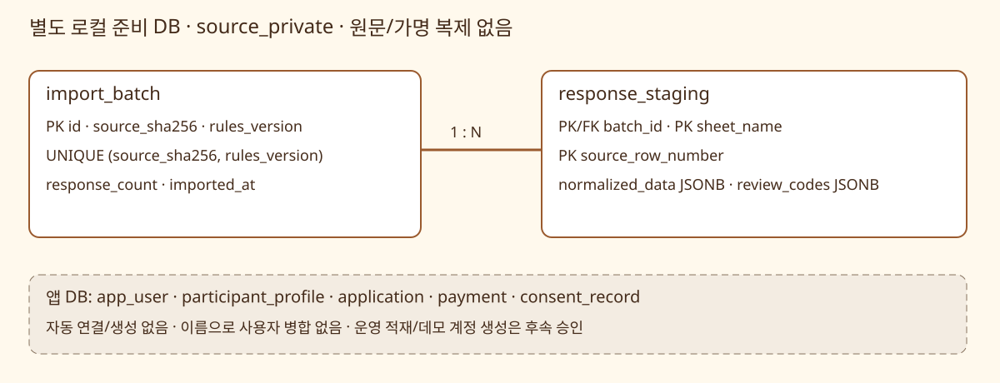

# 제공 데이터 정규화·비공개 준비 DB 적재

위치: 자동 매칭·실패 해결 → 규칙·데이터·정답 기준(Work #5)의 **입력 정규화·누락값·식별 정책 결정 → 가상데이터 변환·DB 시드 구축**. 새 Work/Task는 추가하지 않는다. PR #33은 main `2039eaa`에 머지됐고 이 브랜치는 그 커밋에서 시작했다. [원본 감사](./data-assets-review.md), [ADR-0009](../adr/0009-private-source-preparation.md)가 기준이다.

## 사용자 승인과 실제 범위

2026-10-17 사용자가 ‘추천안 승인: 응답별 식별·누락 보존·비공개 정규화 적재부터’를 선택했다. 294개 원본 응답은 고유 참가자 294명이라는 뜻이 아니다. 이번에는 앱 프로필·신청·결제·동의·이전 만남으로 연결하지 않는다. 자료가 앱 화면이나 자동 매칭에 바로 나타나는 시드가 아닌 준비 단계다.

검증 경계는 기존 사용자 승인된 실제 PostgreSQL·외부 작업 실행기 경계의 CLI다. `preview → load → report`를 별도 프로세스로 실행하고 합성 입력의 알려진 집계·멱등·DB 오류 롤백을 확인한다. schema 접근 거절은 실제 PostgreSQL 역할로 검증한다.

## 정규화 버전 source-preparation-v2

선택 문구 사전은 앱 프로필의 실시간 목록을 가져오지 않는 고정 버전이다. 앱 화면의 문구 변경으로 같은 규칙 버전의 결과가 달라지지 않게 한다. v1 초기 준비 배치에서 선택지 구분자 검사가 부족한 것을 발견해, 원문 재검토 결과를 덮어쓰지 않고 v2로 적재했다.

| 항목 | 처리 |
|---|---|
| 식별 | 원본 SHA-256 + 규칙 버전으로 배치, 시트 + 실제 행 번호로 응답 구분. 가명으로 병합/식별하지 않음 |
| 이름·연락처·Instagram·직업 | 가명과 원문은 DB에 복제하지 않음. 연락처/Instagram/직업은 null과 missing/not_imported 코드로 구별. 성별 자유 문자열도 이번 허용 필드에 포함하지 않음 |
| 나이 | 유효 정수는 source_age로 보존. 기준 연도·나이 방식이 없으므로 birth_year=null, birth_year_unresolved |
| MBTI | 대소문자·주변 공백 정리, 유효 선택 복수 보존. 설명/미인식 문자가 섞이면 전체 목록을 비우고 검토 코드. 비표준 값을 유사 유형으로 고치지 않음 |
| 관심사·성향·지역·식사 가격 | 알려진 원본 선택 문구를 먼저 인식하고 구분자를 처리. 괄호 안 쉼표로 쪼개지 않음. 독서·글쓰기는 reading_writing 통합 원본 분류이며 앱 두 항목 선택으로 바꾸지 않음. 미해석 잔여 문자열이 있으면 해당 목록을 비우고 검토 코드 |
| 날짜 | 연도/회차를 추정하지 않고 검토 코드. 기존 회차로 이동하거나 원본 날짜 문자열을 복제하지 않음 |
| 못 먹는 음식 | 빈 값 unknown, 값이 있어도 unreviewed. 알레르기 없음/안전 확인 완료로 해석하지 않음. 자유 입력 원문은 원본 행으로 재검토 |
| 이용권·동의·신청 순서 | 거래·동의 시각·참가 이력 생성 없음. 원본 행 순서를 선착순으로 쓰지 않음 |

허용되지 않은 문자열을 버린 채 유효 부분만 확정하지 않는다. DB에는 해석된 허용 필드와 검토 코드만 들어가고 원문은 로컬 파일에 남는다. 현재 자료는 모든 행에 출생연도/거래/앱 동의 등이 미정이므로 앱 신청 가능 상태가 아니다.

## 저장과 접근 경계



| 물리 테이블 | 제약 |
|---|---|
| source_private.import_batch | UUID PK, UNIQUE(source_sha256, rules_version), 64자리 hex checksum, 양수 응답 수 |
| source_private.response_staging | 배치 FK, PK(batch_id, sheet_name, source_row_number), 행 번호>2, normalized_data object·review_codes array CHECK |

마이그레이션 `0008_source_preparation`은 빈 schema·테이블만 만든다. 실제 원본을 자동 읽거나 적재하지 않는다. 준비 CLI는 `SOURCE_DATABASE_URL`만 사용하고 loopback의 `serentable_source_` DB 이름만 허용한다. `DATABASE_URL`과 같은 DB, 원격 DB, APP_ENV=production 실행을 거절한다. 소유자/운영자 권한을 가진 DB 계정은 볼 수 있으므로 PUBLIC schema 권한 제거만으로 관리자도 차단된다고 주장하지 않는다. 실제 자료는 별도 로컬 준비 DB에 두고 런타임에 그 연결을 제공하지 않는다.

한 배치와 전체 응답은 한 트랜잭션이다. 중간 오류면 전부 롤백한다. 같은 파일·규칙의 재실행/동시 실행은 이전 배치와 집계를 반환한다. 새 규칙을 도입하면 버전을 바꾸고 이전 배치를 덮어쓰지 않는다. 이 버전 변경은 새 참가자·신청 생성이 아니다.

## 실행

접속 대상 확인을 우회하지 않도록 SOURCE_DATABASE_URL의 query 옵션은 모두 거절한다. 앱 URL에 query가 있어 안전하게 비교할 수 없어도 거절한다. PGHOST·PGHOSTADDR·PGPORT·PGDATABASE·PGSERVICE·PGSERVICEFILE·PGOPTIONS 설정이 있으면 접속 대상/역할 우회를 막기 위해 거절한다(값은 출력하지 않음). 포트 기본값도 명시한다.

로컬 준비 전용 DB를 만들고 기존 운영 지침의 Alembic 명령으로 head까지 적용한다. 다른 개발/운영 DB를 덮어쓰지 않는다. 비밀번호·DB 주소를 PR·Blaybus에 붙이지 않는다. 환경 변수는 자동으로 .env에서 읽지 않는다.

```sh
# 읽기 전용, DB 연결 불필요. 실제 제공 파일 경로를 인자로 전달한다.
PYTHONPATH=backend uv run python -m serentable.source_import preview /absolute/path/source.xlsx

# SOURCE_DATABASE_URL은 별도 loopback 준비 DB로 직접 설정한다.
PYTHONPATH=backend uv run python -m serentable.source_import load /absolute/path/source.xlsx
PYTHONPATH=backend uv run python -m serentable.source_import report <batch-uuid>
```

출력은 checksum·규칙 버전·응답 수·MBTI/관심사/검토 코드 집계·배치 UUID뿐이다. 경로·개별 응답·가명·자유 입력·DB 예외/비밀값은 출력하지 않는다. XLSX 원본을 수정하지 않는다. 시트·헤더 불일치, 수식, 잘못된 cell 참조·중복 행, 과도한 파일/셀/응답 수를 거절한다. XLSX 문자열·수식을 실행하지 않는다.

## 검증과 실제 적재 기록

- 합성 CLI 시험 **13개 PASS**: 복수 MBTI·통합 관심사·누락·원본 불변, 재적재/동시 적재, 중간 실제 DB 오류 롤백·재시도, 비권한 역할 거절, 앱 DB/원격 DB 거절, 수식/헤더 거절, URL/환경 변수에 의한 대상 변경 거절, 구분자 없는 선택지/빈 토큰 검토, 큰 지수 나이 입력의 안전한 거절.
- 제공 원본 미리보기 294행, 기존 SHA-256과 일치. 출생연도/거래/동의 관련 검토294행, 연락처/Instagram/직업 누락294행, 지역 미해석20행, 음식 검토124행, MBTI 미인식4행·설명/잔여 혼합 검토5행. 이는 기존 토큰 검출 감사와 달리 유효 부분만 임의 채택하지 않은 엄격한 선택 판정이다.
- 실제 원본을 PostgreSQL18 전용 준비 DB `serentable_source_preparation`에 적재했다. Docker `serentable-source-prep-pg18`, loopback55440, 전용 named volume `serentable-source-preparation-pg18`에 보존한다. 앱 런타임에는 이 연결을 제공하지 않았다. 비밀번호/연결 문자열은 기록하지 않는다.
- 현재 규칙 v2 배치 `de81f5e7-7d36-49a4-8c0e-ede593df697d`: 294행, 최초 created=true → 재실행 false·같은 배치, 원본 checksum 불변. 지역 미해석은21행이다. 초기 v1은294행/미해석20행이며 구분자 검사 보완으로1행이 검토 대상에 추가돼 v2로 구분했다. 총2개 규칙 배치/588개 변환 이력 행은 원본588명이나 중복 참가자가 아니다. 현재 규칙의 응답 수는294개다.
- 준비 DB의 app_user/application/payment/consent_record는 모두0건으로 독립 집계 확인했다. 과거 날짜·출생연도·실제 거래·앱 동의를 생성하지 않았다. 원본 XLSX·개별 정규화 응답은 Git/PR/정적 자산에 포함하지 않는다.
- 별도 빈 PostgreSQL18 DB에서 0008 up→0007 down→0008 up 왕복 PASS. 실제 준비 배치에 downgrade를 실행하지 않았다.
- 독립 검토에서 URL query 대상 우회(P1), 선택지 사이 문법 검증 누락(P2)을 발견해 외부 CLI RED→GREEN으로 수정했다. 전체 회귀 첫 로컬 실행은132 PASS/마감 경계5 FAIL이었고, 제품 변경 없이 해당5개를 재검증해 PASS했다. 사후 호스트/DB 시계 차이는 약2ms였으나 당시 원인을 확정하지 않았다. 최초 고정 커밋4d1db99 CI38989574156은 전체 검사 SUCCESS였다. 수정 후 최종 CI는 PR checks에서 확인하며 로컬 첫 실패를 전체 통과로 바꿔 적지 않는다.
