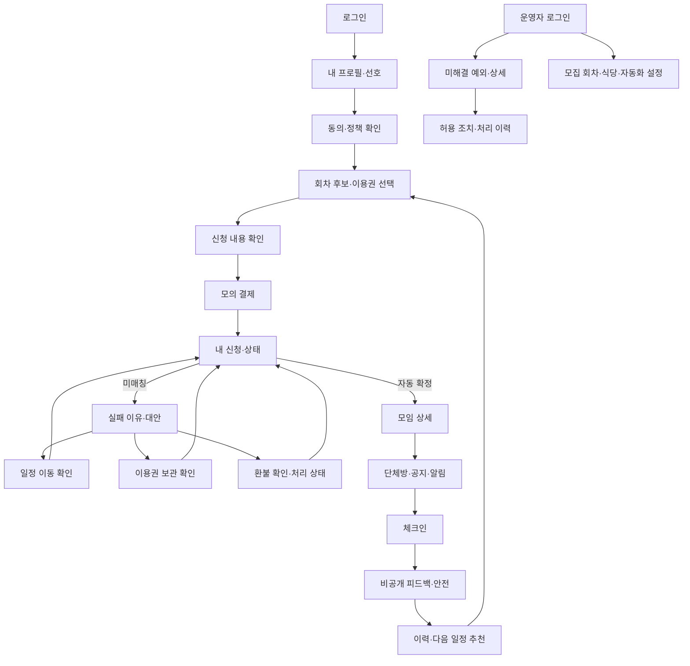

# 공통 UI와 핵심 화면 흐름

산출물: `개발·배포 기반 확보 → 핵심 데이터·화면·보안 설계 → 공통 UI·핵심 화면 흐름 설계` ([Task #18](https://github.com/InryeolChoi/SerenTable/issues/18), 상위 [Work #15](https://github.com/InryeolChoi/SerenTable/issues/15)). 기준일: 2026-10-16, Asia/Seoul.

## 범위와 근거

이 문서는 기능별 구현의 공통 기준으로 검토할 **설계 제안**이다. 화면 이동, 사용자 행동과 상태 표현을 구체화한다. 인증·결제·채팅·매칭 기능이나 모든 화면의 최종 디자인을 구현한 결과가 아니다. 현재 제품의 `/`, `/participant`, `/admin`은 제목과 준비 안내를 보여주는 최소 CSR 화면이다.

[구현 명세](./mvp-implementation-spec.md), [승인된 배치](./design-readiness-plan.md), [요구사항 출처 대조](./requirements-source-comparison.md), [자료 감사](./data-assets-review.md), [용어집](../../GLOSSARY.md)을 기준으로 한다. PRD가 폼과 충돌하면 PRD를 따른다. 신청 날짜·지역은 복수 후보, 상품은 1회권·모의 구독이다. 폼의 3회권 가격·기간을 옮기지 않는다.

상품 가격·기간 내 참여 무제한·실패 횟수에 따른 연장 원칙은 [10/16 공식 FAQ](./official-faq-2026-10-16.md)를 반영했다. 연장 일수·기산점·자동 갱신은 U03 미정이며 임의로 표시하지 않는다.

같은 Work의 [핵심 ERD·상태 설계](./core-data-model.md), [보안 검증 기준](./security-verification-plan.md)과 역할·상태를 맞춘다.

함께 제공하는 [독립 화면 스케치](../prototypes/core-ui.html)는 네트워크 호출·데이터 저장 없는 합성 사례다. 외부 글꼴·이미지·라이브러리를 불러오지 않는다. 로컬에서 파일을 열고 신청 확인, 상태 변경, 실패 해결 선택, 단체방 메시지 시뮬레이션, 피드백과 운영자 예외를 검토할 수 있다. 실제 서비스 동작과 혼동하지 않도록 모든 화면 위에 검토 배너를 둔다.

## 디자인 방향과 검토

서비스의 핵심은 처음 만나는 식사 자리를 안심하고 기다리는 경험이다. 한 화면에서 **현재 상황·다음 시각·할 수 있는 행동**을 우선 보여준다. 매칭 이전에는 사람 얼굴이나 소개 카드로 기대를 만들지 않는다. 상태를 모호한 진행률 하나로 합치지 않는다.

제공 자료의 갈색·크림색, 둥근 6인 식탁과 두 줄 명조 워드마크를 참고해 **재현 시안**을 적용했다. [공식 FAQ Q12](./official-faq-2026-10-16.md)는 유사 재현을 허용한다. 원본 사진·얼굴·운영사 로고는 복제하지 않고 SVG 심볼과 로컬 글꼴만 사용한다. 이는 공식 로고 원본이나 확정 브랜드 가이드가 아니다. [브랜드 대조·검토 기록](./ui-brand-review.md)을 함께 확인한다.

| 토큰 | 재현 시안 | 역할 |
|---|---|---|
| 바탕 | `#FFF9ED` | 제공 자료의 크림색 분위기를 따른 배경 |
| 글자 | `#422817` | 본문·제목 |
| 주색 | `#8B4E27` | 심볼·주요 버튼·선택 상태의 갈색 |
| 완료 | `#405B3A` | 확인·완료 텍스트와 아이콘 |
| 경계 | `#D7C6AF` | 입력·영역 구분, 본문 텍스트에는 쓰지 않음 |
| 보조 | `#6A5847` | 설명·보조 텍스트 |
| 주의 | `#785408` | 재시도·미결정 정책 안내 |

색은 제공 화면을 참고해 선택한 재현용 토큰이며 원본에서 추출한 공식 기준색이 아니다. 헤더는 원형 심볼과 두 줄 `우연한 / 식탁`을 결합한다. 운영사 `와썹하우스`는 하단 텍스트로 분리한다. 단체방의 6좌석 심볼은 브랜드 장식이며 참가 인원은 제목의 `4인 확정`으로 따로 표시한다.

본문은 로컬 `Apple SD Gothic Neo`, `Malgun Gothic`, sans-serif 순서다. 제목만 로컬 `Nanum Myeongjo`, serif를 선택하여 식사 초대장처럼 읽히게 한다. 글꼴 다운로드 없이 한국어 대체 글꼴로도 줄바꿈을 확인한다. 본문 16px·줄간격 1.6, 모바일 주요 제목 28px, 데스크톱 36px, 보조 설명 14px를 기준으로 한다.

모바일은 한 열·본문 최대 46rem, 운영자는 넓은 화면에서 목록과 상세를 나누고 작은 화면에서는 상세를 아래에 둔다. 신청은 위에서 아래로 읽는 순서, 최종 확인 뒤 주요 행동 하나를 둔다. 화면마다 같은 높이의 카드 여러 개를 반복하는 대신 정보의 관계에 따라 구획한다.

첫 초안에서 큰 홍보 문구·인물 카드·장식 사진을 제외했다. 심사 MVP에서 신청 상태와 예외 해결이 더 중요하고, 확정 전 소개는 개인정보 기준과도 충돌하기 때문이다. 강조는 식탁 모양의 좌석 다이어그램 한 곳에 한정한다. 색만으로 상태를 구분하지 않는다.

## 공통 구성 요소와 행동

| 구성 | 기준 | 검증할 행동 |
|---|---|---|
| 주요 버튼 | 화면당 우선 행동 하나, 문구는 실제 결과를 말함 | `신청 내용 확인`, `모의 결제 시작`, `선택한 해결 방법 확인`의 결과가 일치 |
| 폼 | 영구 label·필수/선택 표시·설명·필드 오류, 체크박스는 복수 선택 | 오류 요약에서 해당 입력으로 이동, 기존 입력 유지 |
| 선택 항목 | 날짜·시간·지역을 한 회차 후보로 함께 표시 | 날짜와 지역의 무제한 곱집합을 동의한 범위로 만들지 않음 |
| 저장·전송 | 요청 중 버튼 연속 제출 방지, 결과 조회로 재진입 | 타임아웃을 실패 확정으로 단정하거나 무조건 재결제하지 않음 |
| 상태 | 신청·결제·매칭·참석을 별도 이름으로 표시 | `결제 완료`를 `테이블 확정`으로 표현하지 않음 |
| 확인 | 환불·취소·일정 이동은 대상과 결과를 확인한 뒤 요청 | 반복·경쟁 요청 후 서버의 최종 상태로 갱신 |
| 알림 | 앱 내 알림과 실제 푸시 권한·수신 상태 분리 | 미지원/거절 시 앱 내 안내 유지, 푸시 성공으로 오표시하지 않음 |
| 접근 | 로그인 안내와 권한 거절을 구분 | URL 직접 접근도 서버 검증, 어드민 메뉴 숨김만으로 보호하지 않음 |
| 접근성 | label, heading, landmark, 현재 화면, 키보드 focus, 상태 live 영역 | 360px에서도 가로 스크롤 없음, 44px 이상 터치 목표, 확대·키보드 검토 |

## 화면 지도

경로는 **제안된 화면 식별자**다. 실제 API URL·인증 계약은 각 기능 Work에서 정한다. 스케치 메뉴는 검토용이며 모든 역할의 화면을 한 파일에서 볼 수 있게 했다. 실제 제품은 역할·상태별로 접근을 검증한다.



자동 확정 뒤 식당 배정·채팅 초대·알림은 각각 상태가 다를 수 있다. 확정 테이블은 보여주되 `식당 안내 준비 중`, `단체방 준비 중`으로 구분하고 재시도/운영자 예외를 연결한다. 하나의 성공 문구로 부분 실패를 가리지 않는다.

## 참가자 화면 계약

| 화면 제안 | 내용·주요 행동 | 비정상 상태·이동 | 근거·후속 결정 |
|---|---|---|---|
| `/login` | 허용 테스트 계정 로그인, 세션 만료 후 복귀 안내 | 실패 이유는 계정 존재 노출을 피하고 재입력, 로그인 실패 시 신청 요청 금지 | ACC-01, U01 |
| `/participant/profile` | 이름·연락처·출생연도·성별·직업·Instagram, MBTI·관심사·본인/희망 성향, 가격대·못 먹는 음식·알레르기 | 필수/형식 오류, 저장 실패 입력 유지. 빈 음식 조건을 `알레르기 없음`으로 표시하지 않음 | ACC-02~04, U02/U05/U10/U16 |
| `/participant/consent` | 목적별 동의·운영 정책 버전·정책 전문과 재확인 | 필수 미동의 신청 거절, 새 버전 필요 시 동의 화면 복귀 | ACC-05, U04/U16 |
| `/participant/apply` | 모집 시간·지역·정원·마감, 실제 지원하는 후보 쌍 복수 선택, 1회권/모의 구독 | 모집 없음, 마감 경합, 이미 처리한 신청. 공식 FAQ의 1회권 9,900원과 1/3/6개월 멤버십 35,000/75,000/120,000원, 기간 내 무제한 참여 표시 | APP-01~04, U03/U07 |
| `/participant/apply/review` | 선택한 **날짜·시간·지역 후보 목록**·상품·정책, 개인정보 노출 없는 요약 | 수정 복귀 입력 유지, 회차 변경·만료면 갱신 후 재확인 | APP-02/03, PAY-02 |
| `/participant/payment` | 모의 결제임을 명시, 대상·정책·서버의 실제 금액, 결과 조회 | 대기·실패·재시도, 응답 유실 시 조회 우선. 식사 예산과 참가비를 구분 | PAY-01/02, U03/U04/U12 |
| `/participant/applications/:id` | 네 상태 축·다음 발표 시각·가능 행동·개인정보 없는 설명 | 로딩·빈 신청·조회 실패·권한 거절, 재배치 중 결과 변경 안내 | STA-01~04, MAT-12 |
| `/participant/applications/:id/resolution` | 비식별 실패 이유·대체 일정, 이동/보관/환불의 결과와 확인 | 대안 없음에도 보관/환불 경로 유지. 처리 경합 시 최종 상태 확인 | STA-05/06, PAY-03, U03/U04/U12 |
| `/participant/tables/:id` | 확정 회차·식당명/주소/지도·예약명·집합 시각·가격, 제한된 소개, 안내·콘텐츠 | 확정 전 타인 개인정보 없음. 식당 재고 부족/준비 지연은 명시 | INF-01~06, U10/U16 |
| `/participant/tables/:id/chat` | 멤버 전용 영속 대화·공지·최소 3개 대화 주제, 재연결 | 전송 중/실패·중복 재전송 방지·읽기 복구, 타 테이블 거절. 퇴장 정책은 미정 | CON-01~03, U04/U11/U16 |
| `/participant/tables/:id/check-in` | 허용 시각과 내 참석 결과·반복 체크인 결과 | 허용 시간 밖 거절, 미체크인은 노쇼 후보로만 표시 | FDB-01, U15 |
| `/participant/tables/:id/feedback` | 테이블/대화/식당 별도 평가, 재참여·추천 의향, 비공개 사람별 선호, 신고/차단 별도 동작 | 제출 실패 입력 유지·중복 처리, 타인 평가 공개 없음. 미응답 재신청 허용 | FDB-02~04, SAF-01, U08/U09/U16 |
| `/participant/history` | 내 참가 날짜·지역·피드백 제출 여부, 다음 추천·재신청 | 이력/추천 없음, 종료된 회차 상세의 권한 재검증 | RET-01/02, U08/U16 |
```

프로필에서 Instagram 수집은 요구에 포함된다. 필수성·연락처 검증·다른 참가자 공개는 U02/U16이므로 스케치에 가짜 공개 프로필 카드를 만들지 않는다. 관심사는 사용자 요청 11개(영화 및 드라마, 음악, 독서, 글쓰기, 운동, 맛집 및 카페탐방, 여행, 사진 및 영상, 전시 및 공연아트, 패션 및 뷰티, 자기개발 및 공부)를 입력 후보로 기록하되, 원본의 독서·글쓰기 통합 응답을 자동 분해하지 않는다(U17).

## 상태 문구와 허용 행동

문구는 화면 제안이다. 아래 값의 허용 전이·경합 처리는 ERD 설계 및 기능 구현에서 검증한다. 버튼의 활성 여부는 서버 결과로 정한다.

| 축 | 서버 값 → 사용자 문구 |
|---|---|
| 신청 | DRAFT → 작성 중 / SUBMITTED → 신청 제출 / CANCELED → 신청 취소 |
| 결제 | PENDING → 결제 대기 / PAID → 결제 완료 / FAILED → 결제 실패 / REFUND_AVAILABLE → 환불 선택 가능 / REFUND_REQUESTED → 환불 요청 접수 / REFUND_PROCESSING → 환불 처리 중 / REFUNDED → 환불 완료 / REFUND_FAILED → 환불 실패 |
| 매칭 | WAITING → 매칭 대기 / MATCHING → 조합 확인 중 / REALLOCATING → 동의한 후보에서 재배치 중 / CONFIRMED → 테이블 확정 / ALTERNATIVE_OFFERED → 대체 일정 제안 / TRANSFERRED → 이전 회차에서 이동 / NO_MATCH → 매칭 불가 / EXCEPTION → 운영 확인 필요 |
| 참석 | SCHEDULED → 참석 예정 / ATTENDED → 참석 확인 / CANCELED_EARLY → 사전 취소 / CANCELED_LATE → 마감 후 취소 / NO_SHOW → 노쇼 확정 |

- `MATCHING/REALLOCATING`은 타인 정보나 점수 대신 현재 작업과 다음 조회를 안내한다. 정해지지 않은 완료 시각을 약속하지 않는다.
- 이동은 동일한 참여 의사의 이전 회차 기록 `TRANSFERRED`와 새 회차 기록 `WAITING`을 함께 보여준다. 새 계정·새 결제를 요구하지 않는다. 정확한 신청/참여 식별 모델은 ERD 제안 및 U07에 따른다.
- 보관은 `MatchResolution`의 해결 결과로 보여주며 임의의 `STORED` 매칭 상태를 추가하지 않는다. 보관 후 이용 조건은 U03이다.
- 환불 요청/처리/실패를 완료와 구분한다. 시간 제한·시스템 실패 환불 예외는 U04 확정 전 실제 정책 문구로 게시하지 않는다.
- 노쇼 후보는 운영자 확인 업무다. 단순 미체크인을 참가자에게 `NO_SHOW`로 확정 표시하지 않는다.
- 거절 이유는 `신청이 최신 상태로 변경되었습니다. 현재 결과를 확인해 주세요.`처럼 행동을 안내하고 제외 관계·신고자·다른 참가자 상세 점수를 드러내지 않는다.

## 운영자 최소 흐름

| 화면 제안 | 주요 내용·행동 | 제한·검증 |
|---|---|---|
| `/admin` | 모집/신청/확정 요약, 미해결 예외 우선, 처리 완료 구분 | 요약 수치만으로 정상 흐름 승인 관문을 만들지 않음 |
| `/admin/exceptions` | 식당 부족·안내 반복 실패·데이터/조건 충돌·환불 반복 실패 분류, 상세 진입 | 빈 상태는 `미해결 예외가 없습니다`, 원인·시각·현재 상태, 기본 목록에 연락처/신고 전문 없음 |
| `/admin/exceptions/:id` | 서버가 허용한 조치, 재시도 전 대상·영향 확인, 처리 이유·감사 이력 | 필수조건 무시 확정·결제 상태 임의 덮어쓰기 없음, 중복 조치/권한 거절 |
| `/admin/events` | 회차 날짜/시간/지역·정원·신청 마감·매칭 시각, 모집 상태 | 필수값·시각 관계, 변경 영향/확정 참가자 존재 시 경합 검증, U07/U13/U14 |
| `/admin/venues` | 가상 식당 지역/시간/좌석·음식 조건과 배정 재고 | 미확인 안전 조건을 자동 적합으로 표시하지 않음, 동시 소비 방지, U10 |
| `/admin/participants`, `/admin/matches` | 신청/결제/매칭·이동·참석 이력 조회, 허용된 CSV | 목록 최소 정보, 상세 접근·내보내기 권한·감사, U16 |
| `/admin/safety` | 노쇼 후보 확인, 신고 검토·권한에 맞는 조치·기록 | 접수/확정 구분, 신고 전문은 별도 접근, 경고·제한 정책 U09/U16 |

운영자 화면은 각 기능 Work에서 필요한 부분을 같이 만든다. A5-W1은 이를 종합한다. 최소 점수·가중치 편집 전체를 이번에 새 P0로 확정하지 않는다(U05/U14).

## 공통 비정상 상태

| 상태 | 사용자에게 전달할 내용 | 복구·인수 기준 |
|---|---|---|
| 로딩 | 무엇을 확인하는지, 기존 확정 내용은 유지 | 버튼 중복 처리 방지, 장기 대기 시 조회/재시도 안내 |
| 빈 상태 | 신청 없음·모집 없음·대안 없음·대화 없음·미해결 예외 없음 구분 | 가능한 다음 행동, 없으면 재조회 시점/이유 |
| 네트워크 실패 | 마지막으로 확인한 상태와 확인 시각 | 폼 유지, 안전한 조회 재시도, 변경 요청은 상태 확인 후 재요청 |
| 유효성 오류 | 오류 요약과 해당 label 아래 구체 항목 | 입력 유지·focus 이동·키보드 수정 |
| 상태 경합 | 이미 이동/환불/확정되었음을 최신 결과로 표시 | 과거 CTA 제거, 숨겨진 중복 요청도 서버 거절 |
| 미인증 | 로그인 후 돌아갈 경로 | 타인 식별정보/리소스 존재 노출 방지 |
| 권한 거절 | 접근 권한 없음·내 화면으로 이동 | 타인 신청/테이블/어드민 요청 응답에도 데이터 없음 |
| 부분 실패 | 확정·식당·방·알림의 각 상태 | 준비 중/재시도/예외를 구분, 확정 상태를 허위 취소/완료로 바꾸지 않음 |

## 기능별 후속 설계와 완료 기준

| 다음 Work | 이 문서를 구체화할 내용 |
|---|---|
| 로그인·프로필·동의 | U01/U02/U16, 필드별 필수·형식·공개·수정 권한, 동의 전문/버전과 테스트 계정 |
| 일정 신청·이용권·모의 결제 | U03/U04/U07, 후보 입력 계약, 확정 가격·기간, 반복/실패/경합 화면과 API |
| 규칙·데이터·정답 기준 | U05/U06/U17, 설명 가능한 비식별 이유·원본/생성 데이터 표시 |
| 예약 매칭·재배치·실패 해결 | U07/U12/U13/U14, 선택지 허용 조건과 최신 상태 복구 |
| 식당·채팅·알림 | U10/U11/U16, 공개 소개 최소 항목·방 멤버십·부분 실패·실제 푸시 |
| 참석·피드백·다음 추천 | U08/U09/U15/U16, 입력 척도·체크인 시각·신고/선호 구분 |
| 운영자 종합·제출 | 역할별 거절·마스킹·CSV, 12단계 연결과 접근성·모바일 회귀 |

이번 Task의 인수 기준은 화면 지도·핵심 상태/행동·비정상 상태·운영자 최소 흐름·실제 열어볼 수 있는 모바일 스케치 및 후속 결정 연결이다. 최종 시각 디자인 승인이나 사업 정책 확정을 뜻하지 않는다. 제품 브라우저 E2E·실제 PostgreSQL/실행기 API 검증은 기능 구현에서 수행한다. 문서만을 위해 내부 구현에 결합한 테스트를 추가하지 않는다.

## 검토 기록

검토 결과는 Task PR에 함께 기록한다. 스케치는 합성된 `검토용 회차 A/B`와 `테스트 참가자`를 사용하고 실제 원본·연락처·계정·데이터를 포함하지 않는다. 페이지 새로고침 시 모든 선택은 초기화되며 서버 저장 성공으로 표현하지 않는다. 스케치에서 결과가 바뀌는 것은 상태별 화면을 확인하는 시뮬레이션이다.


### 실제 브라우저 검토 결과

2026-10-16, 로컬 Chrome headless(Playwright 제어)에서 독립 HTML을 열었다. 360×800과 1440×1000 두 viewport에서 아래 행동을 통과했고 JavaScript 런타임 오류는 0건이었다.

- 회차 미선택 오류와 입력 focus, 두 후보 선택 후 후보 쌍 보존·이용권 요약을 확인했다. 선택 변경 시 이전 확인 요약을 숨긴다.
- 대기·매칭·재배치·확정·대안·환불·빈 상태·로딩·조회 실패·권한 거절의 상태 스케치를 전환했다.
- 이동·보관·환불 선택의 서로 다른 확인 내용을 확인했다. 실제 이동·결제·환불은 호출하지 않았다.
- 채팅 합성 입력이 텍스트로 추가되고 HTML 요소로 실행되지 않음을 확인했다. 새로고침 뒤 입력이 초기화됐다.
- 세 평가·재참여·추천 입력, 운영자 예외 상세·조치 검토 안내를 확인했다.
- 위 상태들과 운영자 화면에서 수평 넘침이 없었고, Tab 이동으로 본문 입력에 접근했다. 모바일 신청/상태와 데스크톱 운영자 전체 화면 스크린샷을 열어 잘림·읽기 순서를 육안 확인했다.

이 결과는 스케치 검토다. 실제 iPhone·Android, 스크린 리더, 최종 제품의 인증·API·데이터 보안·푸시·브라우저 E2E 통과 근거는 아니다. 해당 검증은 후속 기능 Work의 인수 기준으로 남긴다.

### 브랜드 보완 후 재검토

같은 날 제공 자료와 공식 FAQ Q12를 기준으로 갈색·크림색, 원형 6좌석 SVG·두 줄 명조 워드마크를 반영했다. 운영사 표기는 서비스 브랜드와 분리했다. 360×1000·390×1000·1440×1000에서 6화면의 수평 넘침·SVG 로드·런타임 오류와 선택 오류/상품 요약·예외 상세·합성 채팅 입력을 재검증했다. 일반 텍스트 대비와 실제 렌더링 육안 확인은 [브랜드 검토 기록](./ui-brand-review.md)에 남겼다. 제품 기능 검증과 구분한다.
